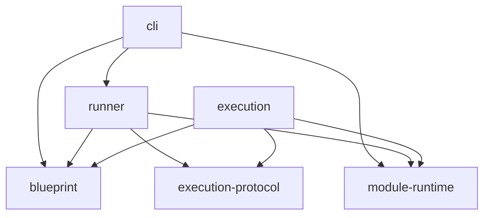

# 内部packageと実行境界

外部には一つの `hanamaru` を提供する。内部packageは、定義を記述する仕事、
実行を取りまとめる仕事、指示された試行を実行する仕事、CLIの入口で分ける。

| package | 所有する責務 | 依存する内部package |
| --- | --- | --- |
| blueprint | Testによる記述、仕様モデル、定義の成立条件、宣言通知 | なし |
| runner | runのUseCase、計画作成、進行、再試行、資源管理、結果集約、worker client | blueprint、execution-protocol、module-runtime |
| execution | workerのhandler、試行、mock、検証、実行側の後始末 | blueprint、execution-protocol、module-runtime |
| execution-protocol | request、response、通知のデータ型と検証schema | なし |
| cli | ファイル探索、定義の取得、runner呼出し、表示、終了コード、CLIの停止監督 | blueprint、runner、module-runtime |
| module-runtime | コード変換・読込、moduleの出自、export差し替え | なし |

図の矢印はimportする側から、importされる側へ向ける。

runnerとexecutionの間の実行時通信はrequest／responseと通知で行う。
clientはrunner、handlerはexecutionが所有する。Plan、進行状態、DIサービスは
通信契約として公開しない。worker内部のサービスはexecutionの外から取得しない。

protocolの `/data` は実行時schemaに依存しないデータ型の入口。
通常入口はデータ型とschemaを提供する。通信値はプリミティブ、配列、
通常のオブジェクトで構成し、関数・Symbol・クラスの参照を運ばない。
MessagePortなどの接続資源は各起動構成が所有し、workerの開始メソッドの引数で渡す。
Configは環境・配布構成の設定値、Injectable serviceは処理と具象依存を表す。
固定サービスの呼出しと資源の寿命を取りまとめる処理はinfrastructure、計画・状態・純粋な判断はapplication/domainに置く。
テスト用のサービス差し替えはonTestやcreateTestTargetのテスト構成で行う。

`hanamaru` の起動構成が各入口を接続し、Test・登録API・CLIを一つの配布物から提供する。
内部packageからこの配布窓口への逆依存を作らない。

## 登録と選択実行

CLIは定義の取得後、runnerのRunTestsへ委譲する。executionの公開面はworker起動入口に絞った。
公開run系APIとproductionのローカル実行は提供しない。
テストコードは定義をregisterTestへ渡す。CLIは登録の収集後にrunnerへ実行を依頼する。
--listで登録定義とケースのIDを取得し、--idまたはfile:宣言行で対象を選ぶ。
caseを絞っても親middleware、要求するresource、workerへ指示する元pathを保持する。
in-sourceではimport.meta.hanamaruのガード内で非公開の実装を参照して登録する。
通常importではこのガードが無効になる。workerは管理されたmodule環境で定義を再取得して実行する。
